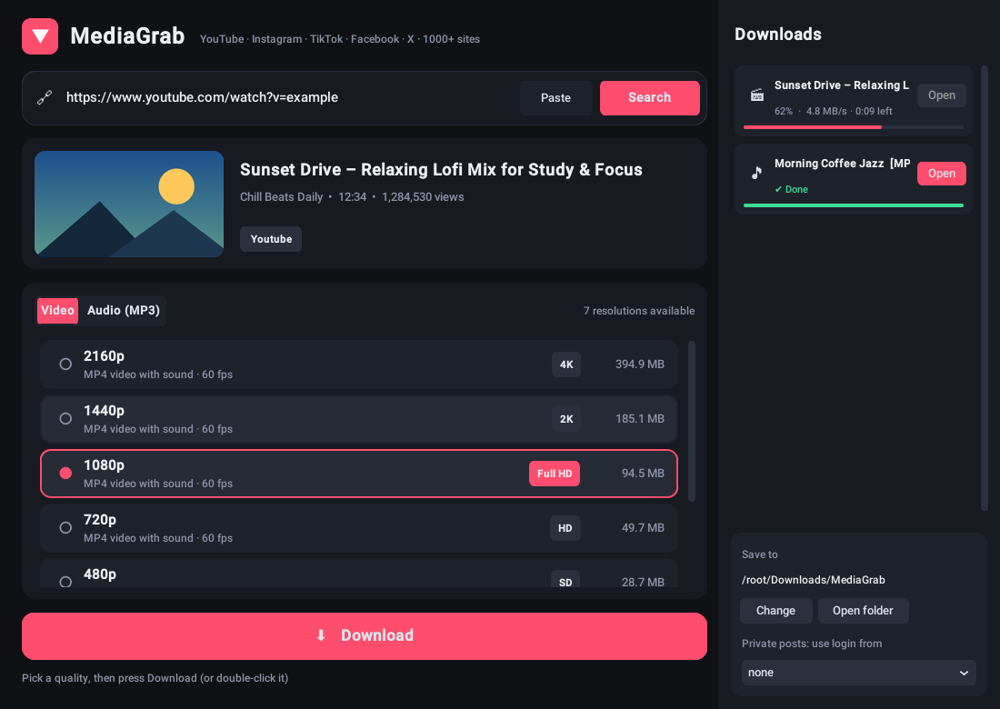

<div align="center">


# MediaGrab

**A simple desktop app to download videos and MP3s from YouTube, Instagram, TikTok, Facebook, X and 1000+ other sites.**

Paste a link → choose a resolution or MP3 → click Download.




</div>

---

## ✨ Features

- 🎬 **Every resolution available**: 8K, 4K, 2K, 1080p, 720p, 480p and more, with the file size of each
- 🎵 **MP3 audio** at 320, 192 or 128 kbps
- 🖼️ **Video preview**: thumbnail, title, channel, duration and views
- 📥 **Download panel**: live progress, speed, time left and an *Open* button for each file
- ⚡ **Several downloads at once**
- 🔒 **Private posts**: can use the login from your browser (Chrome, Edge, Firefox, Brave, Opera)
- 🌙 **Modern dark interface**
- 📦 **No manual FFmpeg setup**: it comes bundled
- 💾 Remembers your download folder and settings

## 🌍 Supported sites

YouTube · YouTube Shorts · Instagram (Reels, posts) · TikTok · Facebook · X / Twitter · Vimeo · SoundCloud · Reddit · Twitch clips · Dailymotion · and [1000+ more](https://github.com/yt-dlp/yt-dlp/blob/master/supportedsites.md).

## 🚀 Installation

### Windows (easiest)

1. Install **Python 3.9+** from [python.org](https://www.python.org/downloads/).
   During the install, **tick "Add python.exe to PATH"**.
2. Download this repository (**Code → Download ZIP**) and unzip it.
3. Double-click **`INSTALL.bat`** and wait 2–5 minutes.
4. Done! A **MediaGrab** icon appears on your Desktop and in the Start menu.

### Run from source (Windows, macOS, Linux)

```bash
git clone https://github.com/<your-username>/MediaGrab.git
cd MediaGrab
pip install -r requirements.txt
python MediaGrab.py
```

> **Linux:** if you get `No module named 'tkinter'`, install it first, e.g. `sudo apt install python3-tk`.

### Build the `.exe` yourself (Windows command prompt)

```bat
pip install pyinstaller
pyinstaller --onefile --windowed --name MediaGrab --icon icon.ico --add-data "icon.ico;." ^
  --collect-all customtkinter --collect-all imageio_ffmpeg --collect-all yt_dlp MediaGrab.py
```

The app will be in the `dist/` folder.

## 📖 How to use

1. Copy a video link from any supported site.
2. Click **Paste**. MediaGrab finds all the available qualities automatically.
3. Choose the **Video** or **Audio (MP3)** tab and pick a quality.
4. Click **⬇ Download** (or double-click the quality).
5. Click **Open** in the Downloads panel to see your file.

Files are saved to `Downloads/MediaGrab` by default. Click **Change** to choose another folder.

## 🛠️ Troubleshooting

| Problem | Fix |
|---|---|
| A site stopped working | Sites change often. Run `INSTALL.bat` again, or `pip install -U yt-dlp`, to get the latest engine. |
| Instagram / TikTok says login required | Log in to that site in your browser, then pick that browser under **Private posts: use login from**. Close the browser first if Chrome/Edge gives a cookie error. |
| "Python is not installed" | Reinstall Python and make sure **Add python.exe to PATH** is ticked. |
| Build failed | Open `build.log` in the app folder to see the error. |
| Windows SmartScreen warning | The `.exe` is built on your own PC and isn't code-signed. Click **More info → Run anyway**. |

## 📁 Project structure

```
MediaGrab/
├── MediaGrab.py       # the app
├── INSTALL.bat        # one-click Windows installer (builds .exe + Desktop shortcut)
├── icon.ico           # app icon
├── requirements.txt   # Python dependencies
├── assets/            # README images
└── LICENSE
```

## 🧰 Built with

- [yt-dlp](https://github.com/yt-dlp/yt-dlp): the download engine
- [CustomTkinter](https://github.com/TomSchimansky/CustomTkinter): the modern UI
- [imageio-ffmpeg](https://github.com/imageio/imageio-ffmpeg): bundled FFmpeg for merging and MP3 conversion
- [Pillow](https://python-pillow.org/): thumbnails and images

## ⚠️ Disclaimer

MediaGrab is for downloading content you own or have permission to download.
Respect copyright and each platform's Terms of Service. The authors are not responsible for misuse.

## 📄 License

[MIT](LICENSE) © 2026 Mohammed Kharroub
